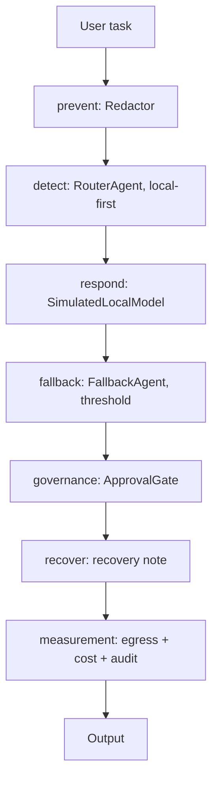

# Local-model agents

**Disclaimer:** This is an independent portfolio project. It is not
affiliated with, endorsed by, or connected to any model provider, cloud
vendor, or company named anywhere in it. All company names, people, and
data in this repo are fictional or synthetic.

## Recruiter summary

A complete offline-capable agent stack built around local open models:
a RouterAgent that routes local-first, a simulated local inference
agent, and a FallbackAgent that labels degraded and cloud-pattern
outcomes explicitly instead of failing silently. Privacy and cost are
measured, not asserted: the egress ledger is empty in every mode, and
the same task set costs less on the local pattern than on the cloud
pattern. Proof: **59 tests, all passing, fully offline** (system
Python 3.12, pytest 9.1.1).

## What this is, stated plainly

The "local model" in this repo is **SIMULATED**: a deterministic
stand-in with fixed rules. It loads no weights, downloads no model,
and makes no network call. The suite runs fully offline and **no test
requires a real model download, real weights, or network access**.
What is real here is the agent behaviour around the model: routing,
fallback, PII redaction, human approval gates, hash-chained audit,
and measurement. Swapping the stand-in for a real local runtime is
planned work, not built work.

The fictional company used in examples is **Vexmere Edge**, a made-up
field-services firm. A web check found no business operating under
that exact name; the nearest results were unrelated firms with
similar-sounding names.

## Purpose and who it is for

For teams that want agents to run on-device -- for privacy, cost, or
offline operation -- and need to see how routing, fallback, gating,
and measurement fit together before committing to a real local
runtime. The stack covers the full loop: prevent, detect, respond,
recover, plus governance and measurement.

## Architecture



Full diagram and notes: [knowledge/architecture.md](knowledge/architecture.md),
[knowledge/local-model-agents.md](knowledge/local-model-agents.md).

## How it works, step by step

1. **Prevent** -- the Redactor strips email addresses, card numbers
   (Luhn-checked), SSNs, and phone numbers before anything else
   touches the task.
2. **Detect** -- the RouterAgent routes local-first. Sensitive or
   redacted content never leaves the local route; only a task asking
   for live external data is labelled for a cloud-pattern comparison.
3. **Respond** -- the simulated local model answers the redacted task
   with a deterministic confidence value.
4. **Fallback** -- below the 0.60 confidence threshold, the
   FallbackAgent returns a `[DEGRADED MODE]` answer or, when allowed,
   a `[CLOUD-PATTERN COMPARISON -- SIMULATED, NOT A REAL CLOUD CALL]`
   answer. Both carry a reason. Fallback is never silent.
5. **Governance** -- risky actions and low-confidence outputs need a
   named-person, single-use, scoped, expiring approval. Bypass,
   denial, expiry, reuse, wrong person, and wrong scope all block.
   Self-contradicting consent ("yes, wait, no") parses as ambiguous
   and never counts as approval.
6. **Recover** -- degraded and comparison outcomes carry a recovery
   note asking for human review.
7. **Measurement** -- every run reports its egress ledger, its cost
   comparison, and a hash-chained audit log that verifies end to end.

## Real code and real output

```python
from local_model_agents.pipeline import LocalAgentPipeline

pipe = LocalAgentPipeline()
result = pipe.run("summarize the weekly status notes")
print(result.mode)            # "local"
print(result.egress)          # []
print(result.audit.verify())  # True
```

Demo output (`python3 examples/run_demo.py`, 6 fictional tasks):

```text
tasks: 6
modes: {'local': 5, 'degraded': 1}
egress entries across all runs: 0
local total for 6 tasks: $0.0012
cloud-pattern total for 6 tasks: $0.0240
saving: $0.0228
local cheaper: True
```

Cost parameters are illustrative model parameters (as of 2026-11-03),
not vendor prices. On a 100-task set the same comparison gives local
$0.02 vs cloud-pattern $0.40.

## How to run

Standard library only -- nothing to install, nothing to download.

```sh
python3 -m pytest tests/
python3 examples/run_demo.py
```

Test run: **59 passed** (system Python 3.12.3, pytest 9.1.1).
Breakdown: privacy 8, audit 4, approvals 10, cost 6, inference 6,
router 5, fallback 6, pipeline 9, brand/offline 5.

## Guardrails and security controls

- PII redaction checklist: phone, SSN, **card numbers**,
  **email addresses** (card candidates Luhn-checked).
- Every confirmation gate tested for bypass, reject, and absent-path,
  plus low-confidence and self-contradicting-consent cases.
- Approvals: named-person, single-use, scoped, expiring.
- Cost/budget inputs reject negatives.
- Brand/name check asserts a non-empty blocklist, stored as SHA-256
  hashes only (never plain names).
- Hash-chained audit: tampering breaks verification (tested).
- Threat model: [docs/threat-model.md](docs/threat-model.md).
- Adoption notes: [docs/implementation-guide.md](docs/implementation-guide.md).
- Decisions: [docs/adr.md](docs/adr.md).

## Limitations and known failures (kept visible)

- Inference is a rule-based stand-in: its "confidence" is a routing
  signal, not a calibrated probability. Do not trust the threshold
  for real decisions until a real local runtime supplies calibrated
  confidence.
- Redaction is pattern-based; adversarially formatted PII can evade
  it. It is a safety layer, not a guarantee.
- Cost figures are illustrative parameters, not measured vendor bills.
- CI is **NOT verified**: the workflow file exists in the scaffold
  but has never run, so nothing here is claimed CI-green.

## Built / Written-not-run / Planned

| Item | Status |
| --- | --- |
| RouterAgent, simulated inference, FallbackAgent | Built, 59 tests passing |
| PII redaction, approval gates, hash-chained audit | Built, 59 tests passing |
| Privacy (egress) and cost measurement | Built, asserted by tests |
| CI workflow file (`.github/workflows/ci.yml`) | Written, not run -- CI NOT verified |
| Real local runtime (actual open-model weights) | Planned, not built |
| Deployment of any kind | Planned, not built -- nothing is deployed |

## Related repos

This repo is a standalone demonstration of local-model agent
behaviour. It overlaps conceptually with model-inference and
agent-orchestration work in the wider portfolio; the code here is
self-contained and duplicates none of it.
