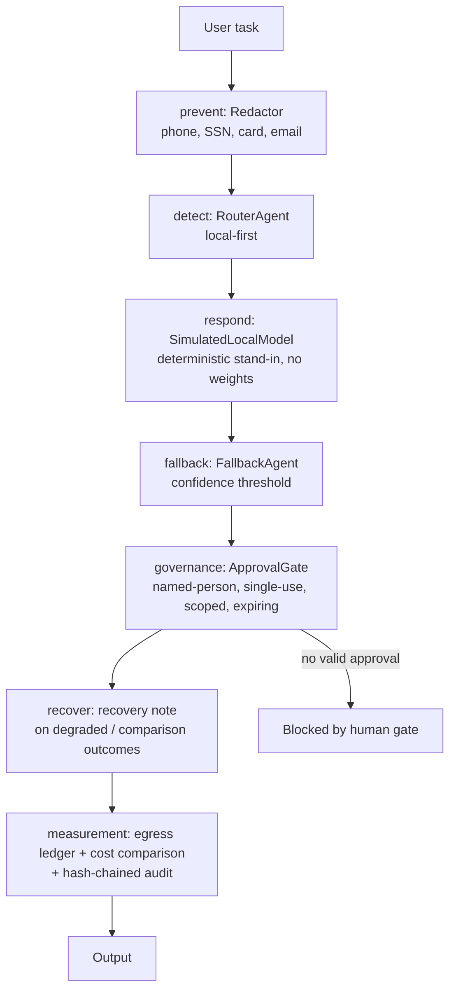

# Architecture

See also:

- [Distilled notes](local-model-agents.md)
- [Implementation guide](../docs/implementation-guide.md)
- [Threat model](../docs/threat-model.md)
- [Architecture decisions](../docs/adr.md)
